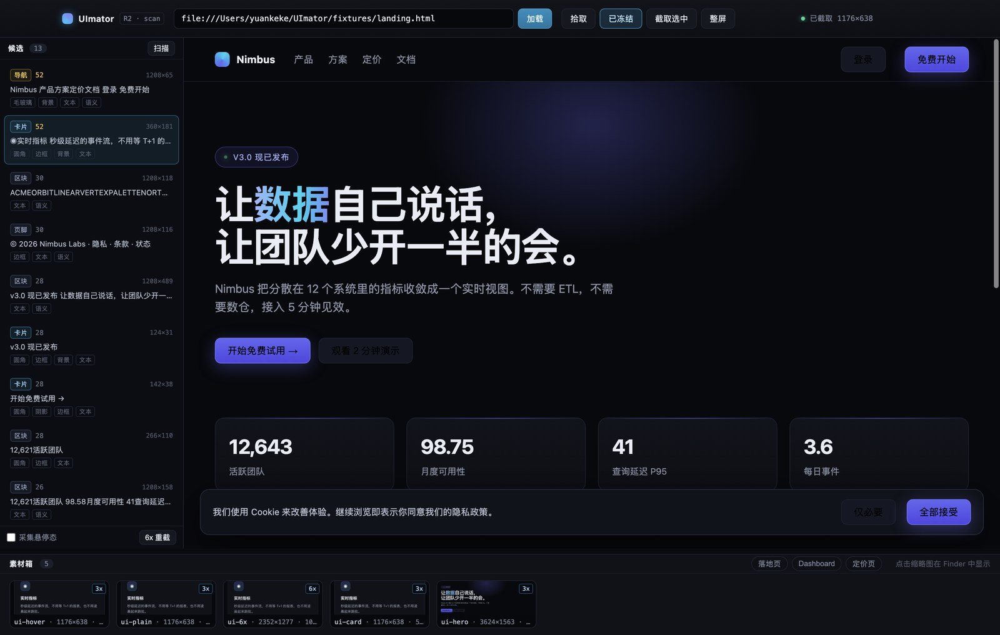
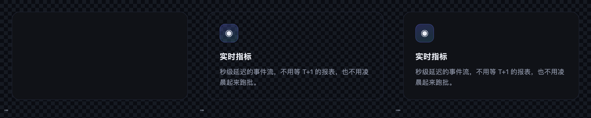
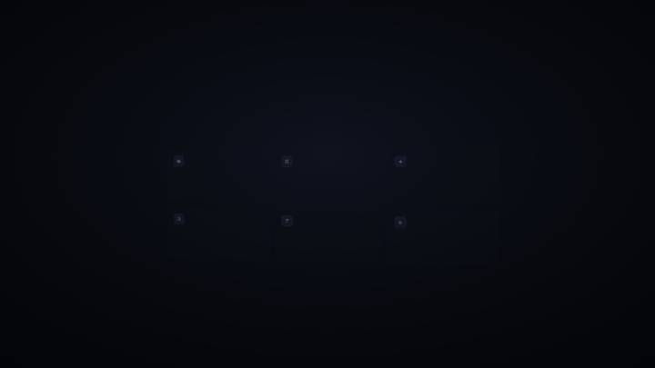

<div align="center">

# UImator

**把跑起来的界面，直接变成一条产品片。**

给它一个 URL。它读 DOM，把界面拆成一棵可寻址的 3D 素材树，
再用镜头、灯光和节拍重新编排。

不需要 Figma 源文件，不需要手工拆图层，不需要会 After Effects。

<sub>Electron · Chromium DevTools Protocol · three.js</sub>

</div>



## 为什么要有它

做一条产品宣发片，现在只有两条路。

**录屏工具**（Screen Studio 一类）很快，但它只能拍"屏幕上的平面"，最多加个缩放和跟随。做不出分层、爆炸、镜头游走。

**AE / Blender** 效果顶级，代价是：把 UI 在 Figma 里重新拆一遍，再一帧一帧 K。一条 30 秒的片子，动效师一周起步，产品一改版就过期。

中间那一段一直空着——

> 界面本来就是结构化的，为什么还要人手工拆一遍？

UImator 填的就是这一段。

## 它做什么

### 读结构，不是读截图

捕获时同时拿到两样东西：每个节点的位图（保住保真度），和它的角色、文本、几何、层级（保住可编程性）。

于是动画可以这样写：

```jsonc
{ "target": "role:card",    "stagger": 60 }          // 所有卡片依次浮起
{ "target": "role:heading", "prop": "textReveal" }   // 所有标题逐字出现
{ "target": "text~'免费开始'", "prop": "translateZ" }  // 按文案找到按钮
```

而不是"第 7 张图往右移 40 像素"。前者换一个网站还能用，后者只能用于一次。

### 拆成能单独运动的层

一张卡片不是一张图，而是底板层 + 图标层 + 标题层 + 正文层，每层带 alpha。

拆开再合回去是无损的——实测与原图平均差异 **0.71 / 255**。



### 给界面一个真实的舞台

Z 轴爆炸、虚拟相机、景深、辉光、颗粒。界面不再是屏幕上的像素，而是舞台上的实体——可以浮起、可以倾斜、可以被镜头穿过。

### 踩着音乐走

BPM、小节线、磁吸点。重拍落大动作，弱拍落小动作，换一首歌不用重剪。

## 它怎么工作

```
捕获  →  结构化  →  编排  →  出片
```

1. **捕获**：输入 URL，或直接连本地 `localhost:3000`。真实浏览器加载，冻结时间与动画，3x 截图。
2. **结构化**：扫描候选，自动打分去重，点选确认。产物是一棵语义树，每个节点带贴图。
3. **编排**：素材进 3D 舞台，按 `role` 绑定镜头、爆炸、逐字动画。
4. **出片**：固定步长逐帧渲染，编码成 MP4。



## 现在到哪了

这是一个**正在建造中的产品**，不是能一键出片的成品。当前进度：

| 阶段 | 内容 | 状态 |
| --- | --- | --- |
| R1 | 捕获链路：CDP 3x 截图、时间冻结、元素拾取、确定性 | ✅ 完成 |
| R2 | 自动拆解、6x 重截、悬停态、配方复现（5/5 像素哈希一致） | ✅ 完成 |
| R3 | 语义树（29 节点 / 重建 0.71–255）+ 3D 舞台 + 相机 | 🟡 舞台已写，WebGL 待真机验证 |
| R4 | 时间轴、节拍对齐、MP4 导出 | ⬜ 未开始 |

12 个真实站点的捕获矩阵全部通过（48 个素材 / 0 失败 / 98.6 秒）；语义树的逐节点重建误差 0.71/255；按配方重截 5 个素材，像素哈希全部一致。

上面那段动图来自 **CPU 预览合成器**——它在没有 GPU 的环境里用透视变换把每个节点投影出来，用来验证构图与节奏。真正的 three.js 渲染管线代码已完成，还缺一台能开 WebGL 的机器做验收。

---

# 开发者

## 文档地图

设计先于代码：13 份 ADR 记录了每条会被迫返工的路线，以及当时为什么那样选。

| 文档 | 作用 |
| --- | --- |
| [docs/architecture.md](docs/architecture.md) | 系统全景、模块边界、三条不变量、性能预算、开放问题 |
| [docs/adr/0001-host-runtime.md](docs/adr/0001-host-runtime.md) | 宿主运行时：为什么必须是 Electron |
| [docs/adr/0002-capture-strategy.md](docs/adr/0002-capture-strategy.md) | 捕获：CDP 位图优先，导出期两遍重截 |
| [docs/adr/0003-stage-renderer.md](docs/adr/0003-stage-renderer.md) | 舞台渲染：全 WebGL，不用 CSS3D |
| [docs/adr/0004-asset-model.md](docs/adr/0004-asset-model.md) | 素材模型：贴图 + 深度语义 + LOD + 文字策略 |
| [docs/adr/0005-scene-timeline.md](docs/adr/0005-scene-timeline.md) | 场景与时间轴：状态节点 + 分段过渡，不用节点图 |
| [docs/adr/0006-export-pipeline.md](docs/adr/0006-export-pipeline.md) | 导出：WebCodecs + 固定步长 + 累积运动模糊 |
| [docs/adr/0007-determinism.md](docs/adr/0007-determinism.md) | 确定性契约：抓取期冻结、导出期纯函数 |
| [docs/adr/0008-untrusted-page-isolation.md](docs/adr/0008-untrusted-page-isolation.md) | 不可信页面的隔离与安全边界 |
| [docs/adr/0009-project-format.md](docs/adr/0009-project-format.md) | 工程文件格式：素材是缓存，配方是真相 |
| [docs/adr/0010-url-mode-boundaries.md](docs/adr/0010-url-mode-boundaries.md) | URL 模式的能力矩阵与降级策略 |
| [docs/adr/0011-beat-sync.md](docs/adr/0011-beat-sync.md) | 节拍对齐：分析、校正、磁吸规则 |
| [docs/adr/0012-layered-assets.md](docs/adr/0012-layered-assets.md) | 分层素材模型：L0→L3，拆开再合回去是无损的 |
| [docs/adr/0013-semantic-tree.md](docs/adr/0013-semantic-tree.md) | 语义树：动画按 role / text 寻址，不按截图坐标 |
| [docs/spikes.md](docs/spikes.md) | 三个验证尖峰与 go / no-go 判据 |
| [docs/round-01.md](docs/round-01.md) | R1 实录：捕获链路、冻结、确定性 |
| [docs/round-02.md](docs/round-02.md) | R2 实录：自动拆解、6x 重截、悬停态、配方复现 |
| [docs/round-03.md](docs/round-03.md) | R3 实录：语义树进舞台、CPU 预览、环境阻塞 |

## 三条不变量

这三条不是设计目标，是**约束**。任何实现如果违反它们，后期一定返工：

1. **素材是缓存，不是真相。** 工程文件里存的是「怎么重新截到这张图」的配方，而不是那张图本身。
2. **舞台上只有一个 canvas。** 不允许 DOM 文本、DOM 图片直接参与构图，否则后期、遮挡、导出全部失控。
3. **任意一帧 = `f(project, t)` 的纯函数。** 不含墙钟、不含未播种随机、不含渲染中途的异步加载。

## 运行

```bash
npm install

npm start          # 打开应用：加载 → 扫描/拾取 → 截取选中（支持 6x、悬停态）
npm run tree       # 把一块 UI 拆成语义树 + 每节点贴图，写 projects/tree.json
npm run stage      # 用 three.js 渲染一段舞台帧（需要可用 WebGL）

npm run matrix     # 12 个真实站点：加载 → 冻结 → 扫描 → 截前 4 个候选
npm run recap      # 按配方重新截一遍，比对像素哈希
npm run selftest   # 无交互跑一遍捕获链路
npm run batch      # 三个 fixture，14 个素材 + 报告
npm run uicheck    # 端到端验证 preload / IPC / 面板 / 缩略图
```

`npm run stage` 依赖 `projects/tree.json`，所以要先跑一次 `npm run tree`。

没有可用 WebGL 时（CI、容器、受限沙箱），用 CPU 预览器出图：

```bash
python3 scripts/preview.py 0.6 1.5 2.4 3.0   # 指定时间点，输出 PNG
```

素材落在 `captures/`，报告落在 `reports/`，工程与语义树落在 `projects/`（都在 `.gitignore` 里）。

受限环境里 Chromium 的沙箱起不来，用 `UIMATOR_SANDBOX=0` 切到无沙箱 + 软渲染；产品默认必须保留沙箱（见 [ADR-0008](docs/adr/0008-untrusted-page-isolation.md)）。

## 下一步

- **R3 收尾**：真机验证 WebGL 舞台；补「浮起」的视觉语法（阴影分离、近大远小），再接后期（景深 / 辉光 / 颗粒）。
- **R4**：状态节点时间轴、节拍磁吸、WebCodecs 导出。
- **R5**：URL 一键出初稿（Director 模板），以及可选的 Bridge SDK。
